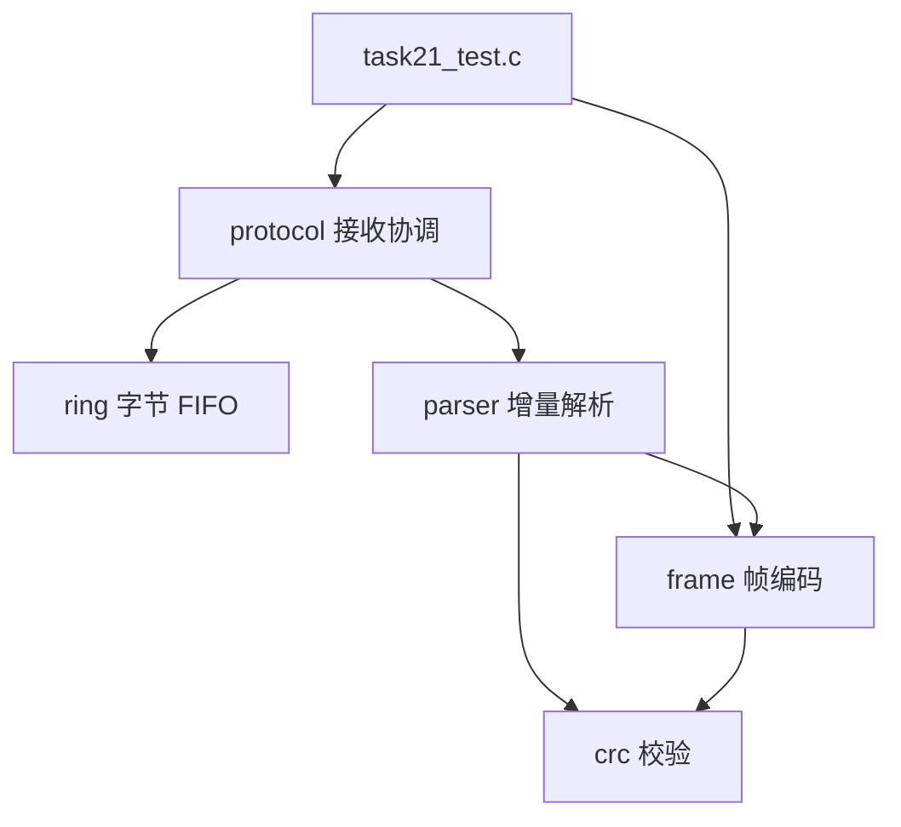
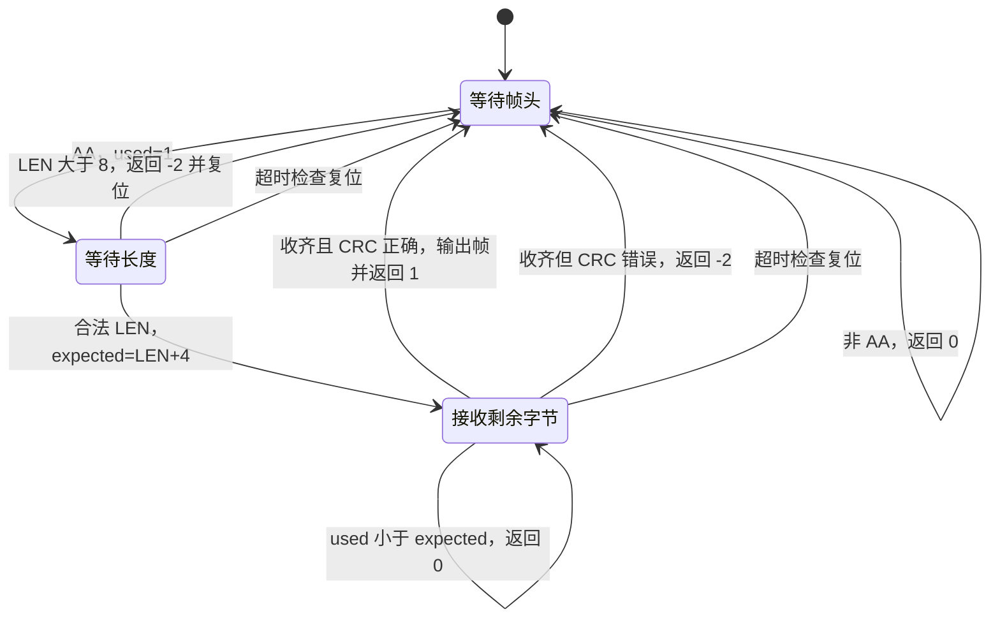

# 任务 1.21：架构与预期结果

更新日期：2026-10-25。本文记录当前综合作品的目标设计、已有验证结果和后续验收要求。目标接口不代表已经全部实现；实际学习过程见 [任务记录](../sessions/2026-10-24-任务1.21-纯C串口协议库综合作品.md)。

## 1. 最终要完成什么

实现一个在 Windows/Ubuntu 主机上可测试的纯 C 串口协议库。调用者提供模拟字节、接收缓冲区和毫秒计数，库负责保存字节、识别完整帧、检查 CRC、丢弃错误候选帧并处理半帧超时。

当前只模拟接收，不连接开发板，不操作真实 UART，不使用线程、中断或动态内存。环形缓冲区按单个执行流程访问，不声称可直接用于中断或多线程并发。

最终预期：编码得到字节流；字节流经过 RX 环形缓冲区和增量解析器后，恢复出原来的命令及 payload。错误或超时后，能够继续接收后续有效帧。

## 2. 文件职责与依赖

代码继续放在 `learning/practice/c_study/`，暂不额外拆目录。

| 文件 | 负责什么 | 主要接口或类型 |
|---|---|---|
| `task21_crc.h/.c` | 按固定参数计算 CRC | `crc8_atm` |
| `task21_frame.h/.c` | 定义帧内容，编码完整帧 | `frame_t`、`frame_encode` |
| `task21_parser.h/.c` | 逐字节识别帧并检查 CRC | `frame_parser_t`、`frame_parser_init`、`frame_parser_push` |
| `task21_ring.h/.c` | 存储待处理字节，维护 FIFO | `rx_ring_t`、`rx_ring_init/push/pop` |
| `task21_protocol.h/.c` | 组合 ring/parser，管理初始化、处理时间和超时 | `protocol_rx_t`、`protocol_rx_init/process/check_timeout` |
| `task21_test.c` | 模拟输入，检查返回值、输出和错误恢复 | 测试入口 `main` |
| `Makefile` | 保存严格编译、依赖和清理规则 | 后续整理，不覆盖旧任务规则 |

头文件提供类型和声明，函数注释放在 `.c` 中定义之前，使用“功能、参数、返回值”格式。不包含其他 `.c` 文件；编译时列出各实现文件。

目标依赖：



ring 只管理字节和下标，不依赖 parser。`frame_t` 只在 `task21_frame.h` 定义一次，parser 通过包含该头文件使用它。

## 3. 协议帧

```text
SOF(1 字节) | LEN(1 字节) | CMD(1 字节) | payload(0~8 字节) | CRC(1 字节)
```

| 字段 | 规则 |
|---|---|
| SOF | 固定为 `0xAA` |
| LEN | payload 的字节数，合法范围 0~8 |
| CMD | 1 字节命令，本任务只传递，不在解析器中解释业务含义 |
| payload | LEN 个字节，可包含 `0xAA`，不能因此在帧中途重新找帧头 |
| CRC | CRC-8/ATM，仅覆盖 LEN、CMD、payload |
| 总帧长 | `LEN + 4`，范围 4~12 字节 |

固定的是字段规则和最大容量，不是每一帧的长度。结构体 `frame_t` 也不直接按内存布局发送，线上字节必须由编码函数生成。

CRC 参数：width=8，poly=`0x07`，init=`0x00`，refin=false，refout=false，xorout=`0x00`。poly 省略了最高项，完整多项式为 `x^8 + x^2 + x + 1`。

独立已知向量：ASCII `123456789` 的 CRC 为 `0xF4`；空输入的 CRC 为 `0x00`。不同数据可能 CRC 相同，CRC 不是绝对无碰撞的校验。

学习者已报告的编码例子：

```text
CMD=20，payload=FF 01
编码结果：AA 02 20 FF 01 BF
总长度：6 字节
CRC 输入：02 20 FF 01
```

## 4. 对象、内存和初始化

目标接收上下文：

```c
typedef struct {
    rx_ring_t ring;
    frame_parser_t parser;
    uint32_t timeout_ms;
    uint32_t last_byte_ms;
} protocol_rx_t;
```

ring/parser 是上下文内部对象；`ring.data` 指向调用者提供的字节数组。ring 容量可以固定为 128 字节作为测试示例，实际由初始化的 capacity 决定。

| 对象 | 谁提供 | 需要保持有效多久 |
|---|---|---|
| `protocol_rx_t` | 调用者 | 整个接收期间 |
| storage 数组 | 调用者 | 整个接收期间，不能在处理函数中临时创建后长期引用 |
| `frame_t` 输出对象 | 调用者 | 至少覆盖当前调用；完整帧返回后可由调用者保存或使用 |
| 编码输入 payload | 调用者 | 当前编码调用期间 |
| 编码输出缓冲区 | 调用者 | 编码调用及后续使用期间 |

初始化只在开始接收时做一次。每次处理字节都重新初始化，会清掉缓冲区或半帧状态。`protocol_rx_process` 必须通过上下文指针修改调用者的对象，不能按值复制上下文。

为集中初始化，计划增加以下公开接口，由学习者后续实现：

```c
int protocol_rx_init(protocol_rx_t *rx,
                     uint8_t *storage,
                     size_t capacity,
                     uint32_t timeout_ms);
```

成功：初始化 ring/parser，保存超时阈值，将 `last_byte_ms` 设为 0，返回 0。rx/storage 为空、capacity 为 0 或 timeout_ms 为 0 时返回 -1，且不改已有状态。所有参数检查应先于状态写入。这里约定超时阈值必须大于 0，不把 0 定义为关闭超时。

统一初始化接口已由学习者实现并通过源码审阅，仍待集成测试。接收对象应在测试程序中创建；不要在 protocol 头文件中定义并初始化全局 rx，否则多个编译单元包含该头文件时会产生重复定义。

## 5. 数据流和接口返回值

```text
frame_encode 生成字节流，或测试直接提供字节流
    → 调用 rx_ring_push，每次保存一个字节
    → 重复调用 protocol_rx_process
        → rx_ring_pop 取出最多一个字节
        → frame_parser_push 消费该字节
        → 返回 1 时得到一帧完整有效的 frame_t
```

| 接口 | 成功或正常状态 | 错误状态 |
|---|---|---|
| `crc8_atm` | 0，写 CRC；空输入输出 0 | -1：NULL 输出，或 NULL 数据且长度非零 |
| `frame_encode` | 0，写完整帧和总长度 | -1：参数非法、payload 超限或容量不足 |
| `rx_ring_init` | 0，绑定 storage 并清空下标/count | -1：非法指针或容量为 0 |
| `rx_ring_push` | 0，存入一个字节 | -1：非法上下文；-2：已满 |
| `rx_ring_pop` | 0，取出最早一个字节 | -1：非法上下文/输出；-2：已空 |
| `frame_parser_init` | 无返回值，清除候选帧；NULL 时不操作 | 无 |
| `frame_parser_push` | 0：未完成或帧外字节；1：完整有效帧 | -1：NULL 参数；-2：非法 LEN 或坏 CRC，并重置候选帧 |
| `protocol_rx_process` | 0：未输出帧；1：输出完整有效帧 | -1：非法参数；底层解析 -2 映射为 0 |
| `protocol_rx_check_timeout` | 0：无需复位；1：发生超时并已复位 | -1：非法上下文 |

编码错误时不修改 out 和总帧长。当前学习者编码实现约定 payload 与 out 不重叠；`frame_length_out` 也不能与 out 存储区域重叠。不把已删除参考实现的重叠支持视为学习者实现的能力。

解析输出只在返回 1 时有效写入；其余返回值不改 `frame_out`。payload 数组中下标大于等于 payload_length 的内容不作规定，测试不应要求它们清零。

ring 已满时拒绝新字节，不能覆盖仍未处理的数据；调用者必须检查 push 返回值。丢失字节意味着流可能不再完整，本任务不承诺在任意丢字节场景下立即无误恢复。确定性的恢复测试使用明确重置或等待半帧超时，再输入新的完整有效帧。

## 6. 增量解析状态



`used` 是当前候选帧累计收到的字节数。收到合法 LEN 后，`expected` 才成为已知的总长度。CRC 从 `bytes[1]` 开始计算 `expected - 2` 个字节。

本任务采用简单恢复：发现非法 LEN 或坏 CRC 后，丢弃当前候选帧，后续调用重新等待 SOF。不向后扫描已丢弃候选帧中的嵌套帧头；需要确认能从后续完整有效帧恢复。

## 7. 超时规则和调用顺序

这里的时间是“从 ring 取出并处理字节的时间”，不是硬件收到字节的时间。ring 仅保存字节，没有保存真实接收时间。真实 UART 到达间隔的超时检测不在当前设计能力之内。

目标接口：

```c
int protocol_rx_process(protocol_rx_t *rx,
                        uint32_t now_ms,
                        frame_t *frame_out);

int protocol_rx_check_timeout(protocol_rx_t *rx, uint32_t now_ms);
```

process 声明和定义已同步为上述三参数版本，并已接入前置超时检查及处理时间记录，源码审阅通过；测试仍需增加 process 的完整链路调用。

规则：

1. `parser.used == 0`：没有候选帧，不超时。
2. `parser.used > 0`：已有候选帧，哪怕只收到一个 AA，也需要检查。
3. 使用 `uint32_t elapsed_ms = now_ms - last_byte_ms` 计算经过时间。
4. `elapsed_ms >= timeout_ms` 时超时，边界等于阈值也要复位。
5. 超时只重置 parser，不清空 ring，不输出 frame；`last_byte_ms` 不必因超时而更新。
6. process 成功取出字节并交给 parser 后，更新 `last_byte_ms = now_ms`；空 ring 调用不更新时间。
7. 毫秒计数按 uint32_t 回绕时，只要实际间隔小于完整的 2^32 毫秒计数周期且时间按相同计数源前进，无符号差值仍可计算该间隔。

为避免把已经超时的旧半帧继续拼接，目标调用顺序固定为：process 检查参数后先做超时检查，再 pop 当前字节、交给 parser，最后记录处理时间。若超时检查发生了复位，process 继续处理本次能取出的字节，其返回值仍按“是否输出完整帧”解释；需要单独观察超时事件时，可先显式调用 check_timeout。

没有字节到来时，调用者也要周期调用 check_timeout，或调用带有超时检查的 process。库不会自动计时或自动执行。

| 场景（timeout_ms=20） | 预期结果 |
|---|---|
| 尚未收到 SOF，时间过去很久 | 返回 0，不误报超时 |
| 100 ms 处理 AA，119 ms 检查 | 19 ms，返回 0，保留候选帧 |
| 100 ms 处理 AA，120 ms 检查 | 20 ms，返回 1，清除候选帧 |
| 110 ms 处理最后一个候选帧字节，135 ms 检查 | 25 ms，返回 1 |
| 空 ring 时调用 process | 不更新时间；旧候选帧仍可能被超时检查清除 |
| 超时后再次检查，无新 SOF | 返回 0，不重复报告同一次超时 |
| 超时后输入新的完整有效帧 | 恢复并输出该帧一次 |
| last=0xFFFFFFF0，now=0x00000004 | 经过 20 ms，到达超时边界 |

调用者应及时处理 ring 中的数据。若将缓存搁置超过阈值，处理时间模型可能丢弃旧候选帧，即使这些字节实际较早就已经到达；这是当前模型的明确限制。

## 8. 当前完成情况与待办

以下状态以源码审阅、学习者提供的命令和运行输出为依据，不将设计文档当成实现或测试证据。

| 部分 | 当前状态 | 后续动作 |
|---|---|---|
| CRC | 源码审阅通过，学习者严格编译和 4 项测试通过 | 在集成测试中继续使用独立已知向量 |
| 帧编码 | 源码审阅通过，学习者严格编译和边界测试通过 | 新接口集成后回归 |
| 增量解析 | 源码审阅及既有单模块测试通过；完整工程严格编译、拆包/连续帧和错误后恢复运行通过 | 保留已有证据 |
| 文件职责整理 | 已新增 protocol 文件，frame_t 已移入 frame 头文件 | ring 头文件仍需移除无用的 parser 包含 |
| ring/process | 源码审阅通过；学习者七组测试包含 FIFO/满空/下标回绕及完整接收链路，运行通过 | 转入构建整理及调试 |
| 时间字段与接口 | 时间更新、空队列超时、新帧头保留及 tick 回绕运行通过 | 转入调试 |
| timeout | 源码审阅通过；19/20 ms 边界、超时恢复和计数回绕测试通过 | 保留已有证据 |
| protocol_rx_init | 已实现，源码审阅通过；头文件全局 rx 已移除 | 验证初始化与非法参数 |
| 接收链路集成 | 学习者完整工程严格编译成功，七组 90 PASS/0 FAIL、退出码 0；覆盖完整帧、超时边界/恢复、FIFO/满空/下标回绕、拆包/连续帧、坏 LEN/CRC 恢复和 tick 回绕 | 不将未覆盖条目自动标为通过；下一步构建整理及 GDB |
| Makefile/GDB/阶段验收 | 严格命令行构建和七组测试已通过；`task21.mk` 源码审阅通过；GDB 核心观察均有操作记录；阶段闭卷 90/100，作品 86/100 | 本阶段结项。非阻塞改进项见任务 session |

阶段结论（2026-10-25）：作品通过验收，86/100；闭卷测验 90/100；变量内存区域与生命周期说明通过。阶段 1 结项。评分改进项及未覆盖的计划条目保留在 session 中，不作为已经验证的能力。

## 9. 集成测试的输入与预期结果

不要求重新单独编写三份 ring 函数测试；下面的 ring 性质在完整接收链路中覆盖。测试只通过函数接口驱动对象，允许只读观察公开状态以核对不变量，不直接改写内部下标来伪造场景。

| 验收项 | 怎么输入 | 预期结果 |
|---|---|---|
| 初始化 | 合法 storage/capacity/timeout | ring 为空，parser 无候选帧，阈值保存正确 |
| 非法初始化 | NULL、容量 0、超时阈值 0 | 返回 -1，不破坏原有效状态 |
| 空接收队列 | 初始化后调用 process | 返回 0，不修改输出帧，不更新 last_byte_ms |
| 正常链路 | 编码→逐字节入队→处理 | 恰好输出 1 帧，命令、长度、有效 payload 正确 |
| 空 payload | LEN=0 的合法帧 | 总长 4，成功输出空 payload 帧 |
| 最大 payload | LEN=8 的合法帧 | 总长 12，所有 8 个字节一致 |
| FIFO | 多个不同字节或帧按序入队 | 出队及帧输出顺序不变 |
| 下标回绕 | 通过入队/出队让读写下标绕回，再发送完整帧 | 数据未丢失、未重复，仍正确输出 |
| 队列已满 | 填满后再 push 一个字节 | 返回 -2，原排队字节、下标和 count 不改变 |
| 拆包 | 只推入前半帧，处理至 ring 为空；未超时前再推后半帧 | 前半段无输出，后半段完成后输出 1 帧 |
| 粘包 | 连续输入两帧 | 按序输出 2 帧，各只输出一次 |
| 帧前垃圾 | 输入非 AA 字节后接合法帧 | 垃圾被忽略，合法帧可输出 |
| payload 含 AA | 合法 payload 中包含 0xAA | 作为 payload 处理，不中途重启 |
| 非法 LEN | AA 后输入 9，再输入完整合法帧 | 底层报 -2 并复位，上层继续处理后恢复输出 |
| 坏 CRC | 修改一帧的 CRC，再紧接完整合法帧 | 错帧无输出，下一帧正常输出 |
| 单字节半帧超时 | 只处理 AA 后推进到阈值 | 能超时，used 不必达到 3 |
| 阈值前/正好阈值 | 对比 elapsed=19、20，阈值=20 | 前者保留，后者复位 |
| 新字节更新时间 | 未超时前连续处理候选帧字节 | 每次从新的 last_byte_ms 计算等待时间 |
| 无数据时超时 | 不再 push，但继续调用超时检查 | 候选帧按时被清除 |
| 超时不清 ring | 已有半帧且 ring 中还有待处理字节，显式检查超时 | parser 清空，ring 内容和 count 不变 |
| 超时后恢复 | 超时清掉半帧后，再输入全新完整帧 | 输出新帧一次 |
| 时间回绕 | 提供第 7 节的模拟 tick | 按无符号时间差触发正确边界 |
| NULL 参数 | 对公开接口传入各类 NULL | 遵守返回值契约，不崩溃、不非法写输出 |
| 处理返回 0 | 在半帧、垃圾、坏帧、空队列等场景检查 | 输出 frame_t 保持不变 |

测试用例要同时检查返回值和有效输出，不只是打印数据。失败必须使程序返回非零；全部通过返回 0。不能仅用本库 encode→parse 的相互一致证明 CRC 正确，仍保留 `123456789 -> F4` 这一独立向量。

一次 process 最多取一个字节，返回 0 不代表队列已空。测试可在 `rx.ring.count > 0` 时循环处理，并在每次返回 1 时统计和检查帧；无数据时另外调用超时检查。

## 10. 构建、调试与最终交付

完整目标构建命令（待时间接口同步完成后，由学习者执行）：

```powershell
gcc -std=c11 -g -O0 -Wall -Wextra -Werror task21_test.c task21_crc.c task21_frame.c task21_parser.c task21_ring.c task21_protocol.c -o task21_test.exe
.\task21_test.exe
$LASTEXITCODE
```

不要把旧任务含 main 的源文件或另一份 frame_encode 参考实现加入上述编译。当前目录中的旧 Makefile 仍面向早期练习，需要后续整理为本任务构建规则。

预期结果：严格编译无诊断；约定测试全部 PASS；有明确总结果；`$LASTEXITCODE` 为 0。本文不预设最终测试条数，必须按覆盖项核对。

调试验收：学习者使用 GDB 展示普通断点、条件断点、调用栈、变量和内存查看。例如在 parser 函数入口用 `parser->used == 1 && byte > 8` 观察非法 LEN 路径，用 `x/12bx parser->bytes` 查看候选帧。具体命令随当时源码行号调整。

阶段知识验收：至少说明 5 类变量的常见内存区域与生命周期，例如函数局部对象、静态局部对象、文件作用域对象、动态分配对象和字符串字面量；不要求为了凑类型给本协议库增加 malloc。闭卷测验与阶段作品分别达到 80 分。

最终保留：模块源码/头文件、集成测试、构建规则、本文设计说明、学习者提供的测试与调试证据、任务结项记录。任务 1.7 动态运行库兼容构建仍为延期项，不能因本作品进展而虚报完成。
